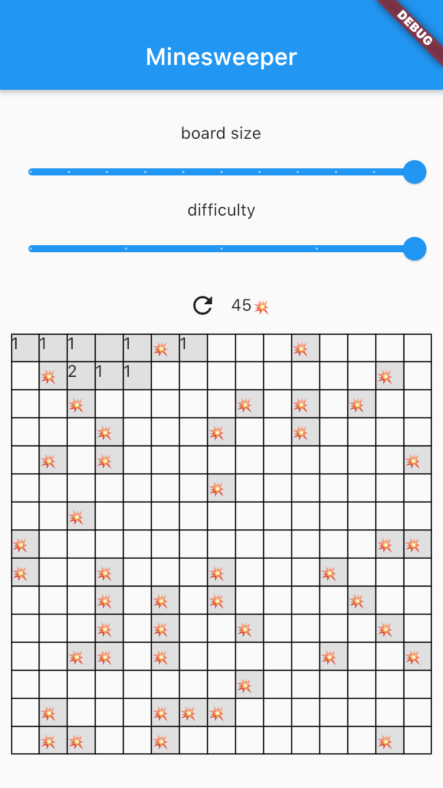
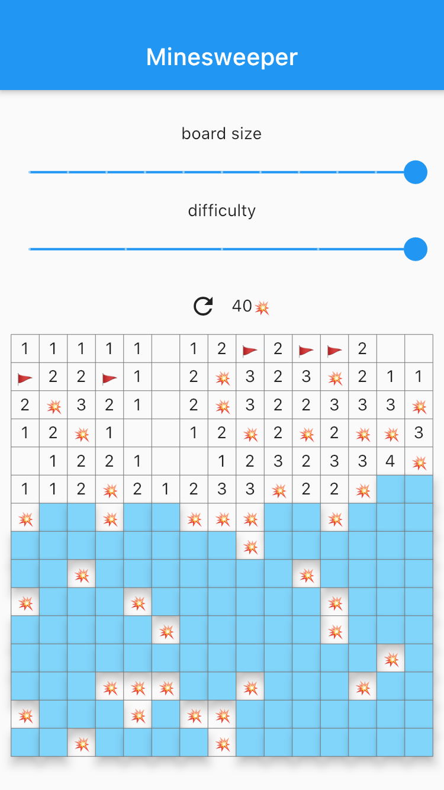
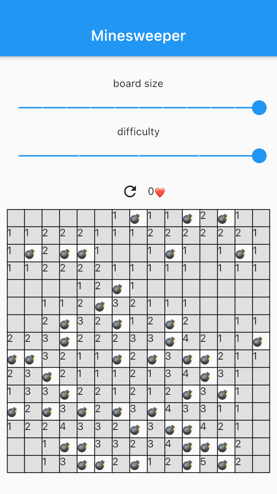

[](https://github.com/pre-commit/pre-commit)

[](https://play.google.com/store/apps/details?id=com.actvst.bobagold.minesweeper)
[](https://apps.apple.com/de/app/meinsweeper/id1521149028)
[](https://itsallwidgets.com/minesweeper-game)

# minesweeper

Minesweeper game.

## Screenshots
<p align="center">
    
    
    
</p>

## Features

* Responsive design - fits portrait, landscape, split-screen, tablet
* Tests
* Rive animations:
    * https://rive.app/community/files/11975-22809-kawaii-animals-crying/
    * https://rive.app/community/files/11976-22810-kawaii-animals-giving-love/

## Development

iOS and macOS native dependencies use Swift Package Manager. CocoaPods is not
required. Open the platform's `Runner.xcworkspace` when working in Xcode.

After fetching dependencies, prepare Rive's native library for widget tests:

```sh
flutter pub get
dart run rive_native:setup --clean --platform macos
flutter test
```

Use `--platform linux` or `--platform windows` on those hosts. Repeat the setup
after `flutter clean`, which removes the native test library from the build folder.
The setup command's `--clean` flag restores that library even when the download
was previously cached.
App builds download their required Rive libraries automatically.

## Todo

* Performance #2
* Cell widget
* Improve code style
